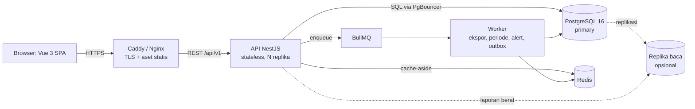
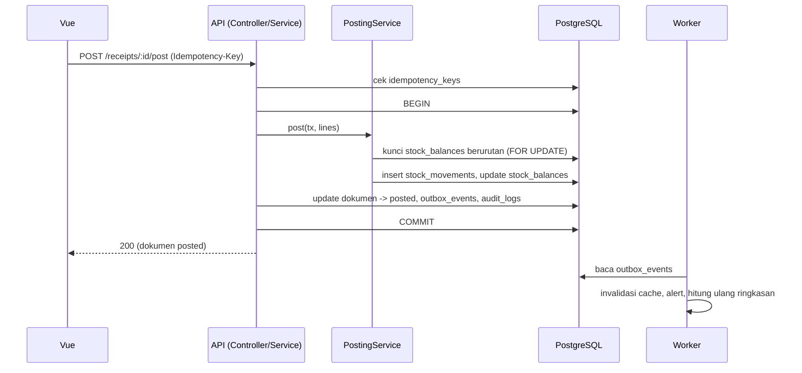
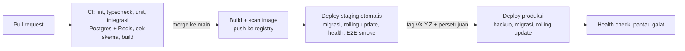

# Arsitektur

> Proyek terdiri dari **dua repositori**: `depo-farmasi-backend` (API, worker, database, deploy) dan `depo-farmasi-frontend` (SPA Vue). Kontrak antar keduanya adalah OpenAPI (`docs/openapi.json` di backend). Struktur folder: lihat `docs/STRUCTURE.md` di masing-masing repo.

## 1. Gambaran

Frontend (Vue SPA) dan API (NestJS, modular monolith) dipisah dan di-deploy sendiri. PostgreSQL adalah satu-satunya sumber kebenaran; Redis untuk cache dan antrean; worker memakai kode backend yang sama.

## 2. Modul backend

| Modul | Tanggung jawab | Fase |
| --- | --- | --- |
| `auth`, `users`, `roles` | Login, token, RBAC, lingkup lokasi | 0 |
| `audit` | Penulisan `audit_logs`, interceptor | 0 |
| `platform` | Idempotensi, penomoran dokumen, outbox, health, cache helper | 0 |
| `master` | Item, kategori, satuan, bentuk sediaan, supplier, lokasi, parameter perencanaan | 1 |
| `imports` | Impor Excel (dry-run, eksekusi, rekonsiliasi) | 1 |
| `stock` | `PostingService`, saldo, batch, ledger, tampilan stok | 1 |
| `receiving` | Penerimaan dan retur ke PBF | 2 |
| `issuing` | Permintaan, pengeluaran, mutasi, retur apotek, expired | 3 |
| `opname` | Opname dan penyesuaian | 4 |
| `planning`, `procurement` | Rencana 3 bulan, PO, jadwal kirim | 5 |
| `reporting` | Ringkasan periode, laporan, dashboard, ekspor, alert | 6 |

Aturan ketergantungan: modul hanya memanggil service modul lain yang diekspor secara eksplisit; `stock` adalah satu-satunya modul yang menulis `stock_balances` dan `stock_movements`.

## 3. Alur posting dokumen

## 4. Cache

| Data | Lapisan | TTL | Invalidasi |
| --- | --- | --- | --- |
| Item, kategori, supplier, lokasi | Redis + ETag + TanStack Query | 1 jam / 5 menit | Event outbox saat berubah |
| Hak akses pengguna | Redis | 10 menit | Saat peran berubah / logout |
| Agregat dashboard | Redis | 30-60 detik | Kedaluwarsa |
| Aset FE | CDN / reverse proxy | 1 tahun (hash) | Hash baru tiap build |
| Saldo, mutasi, dokumen | **Tidak di-cache** | - | - |

Kunci: `v1:item:{id}`, `v1:items:list:{hash}`, `v1:ref:locations`, `v1:perm:{userId}`. Aplikasi tetap benar bila Redis mati.

## 5. Antrean dan job terjadwal (worker)

| Job | Pemicu | Keterangan |
| --- | --- | --- |
| `outbox.process` | Polling tiap beberapa detik | Invalidasi cache, alert, ringkasan |
| `partitions.ensure` | Bulanan | `ensure_future_partitions(3)` |
| `period.close` | Bulanan / manual | Mengisi `stock_period_summaries` |
| `moving.classify` | Harian/mingguan | Kelas moving otomatis (tidak menimpa manual) |
| `report.export` | Permintaan pengguna | Ekspor Excel/PDF |
| `idempotency.purge` | Harian | Hapus kunci kedaluwarsa |
| `alerts.scan` | Harian | Stok kritis, ED, PO terlambat |

## 6. CI/CD

- Berkas: `.github/workflows/ci.yml` dan `deploy.yml` di **masing-masing repo**. Backend menyimpan `deploy/` (compose, Caddy, skrip deploy); frontend men-deploy hanya layanan `web` lewat skrip yang sama di server.
- Migrasi dijalankan sebelum aplikasi baru; kompatibel mundur (expand/contract) agar rollback image aman.
- Rahasia di GitHub Environments / secret manager; tidak ada di repo.
- Lingkungan: `dev` (lokal, `docker-compose.yml`), `staging`, `production`.
- Hosting awal: Docker Compose (`deploy/docker-compose.deploy.yml`) di satu server dengan Caddy; jalur naik ke Kubernetes/OpenShift bila diwajibkan infrastruktur RS (keputusan terbuka Fase 0).

## 7. Skalabilitas

- **Aplikasi:** API dan worker stateless, dapat ditambah replika; sesi di JWT + refresh token di DB.
- **Database:** PgBouncer; indeks sesuai pola akses; ledger dan audit dipartisi bulanan; tabel ringkasan untuk laporan; replika baca untuk laporan berat; keyset pagination.
- **Jalur tumbuh:** bila menjadi multi-depo/RS, tambahkan `facility_id` dan sub-partisi hash pada tabel stok; pisahkan worker laporan; pertimbangkan pemisahan modul `reporting` menjadi layanan tersendiri.
- **Tidak dilakukan lebih awal:** microservice, sharding, event sourcing penuh; ditunda sampai ada bukti kebutuhan.

## 8. Observabilitas dan operasi

- Log terstruktur (pino) dengan `request_id`; Sentry untuk galat; `/health/live` dan `/health/ready`.
- Metrik dasar (latensi, galat, kedalaman antrean, koneksi DB) dan alarm pada galat tinggi atau antrean menumpuk.
- Backup harian + arsip WAL (PITR); latihan pemulihan tiap kuartal; runbook rollback.

## 9. Konvensi API (ringkas; rincian di `.agents/rules/30-api-security.md`)

`/api/v1`, REST jamak; keyset pagination `{ data, next_cursor }`; error RFC 7807 dengan `code` stabil; `Idempotency-Key` pada POST pengubah stok; OpenAPI sebagai kontrak dan sumber klien FE.
