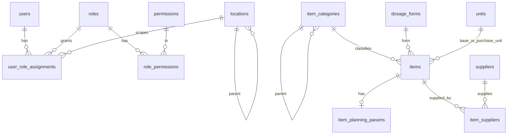
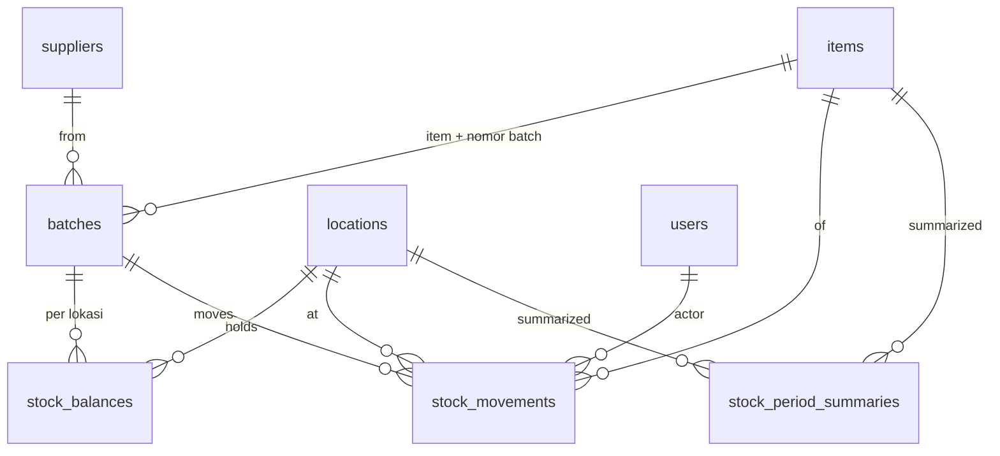
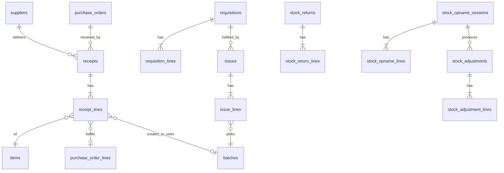
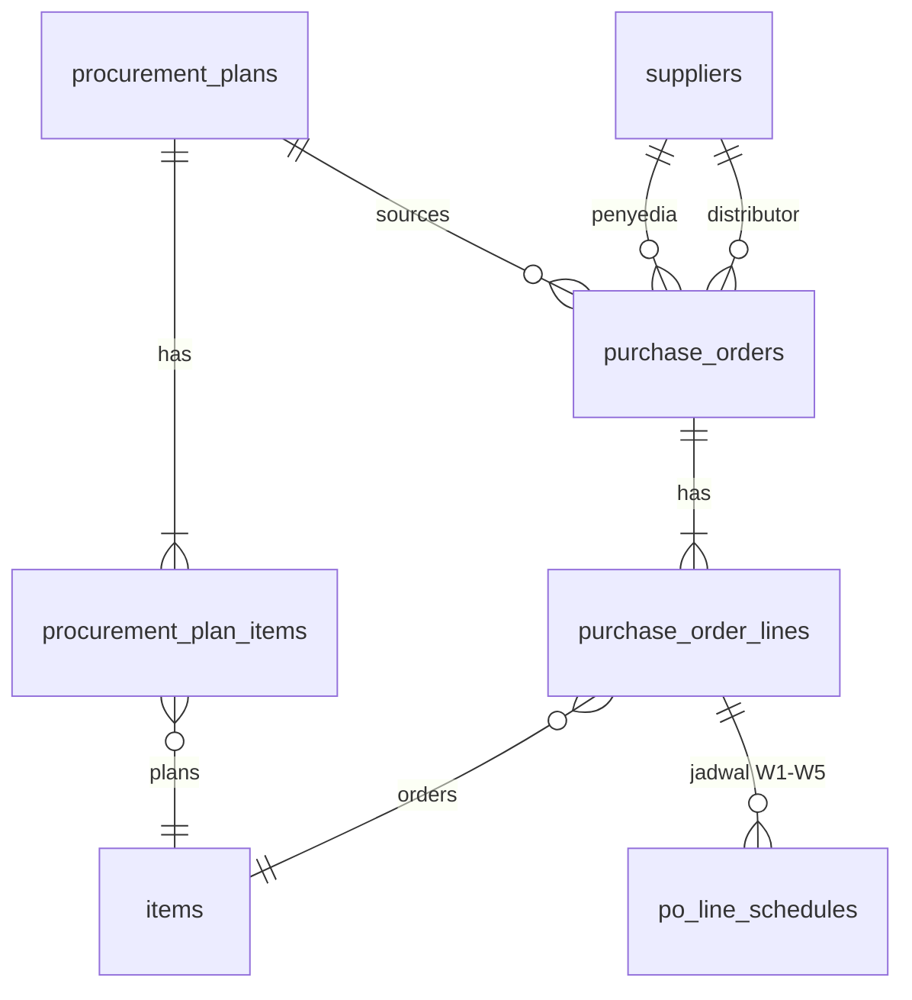

# ERD: Depo Farmasi

Diagram ini menampilkan tabel utama dan relasinya (atribut dipangkas). Definisi lengkap ada di `schema.sql`.
Semua PK = UUID v7. Tabel `stock_movements` dan `audit_logs` dipartisi bulanan.

## Master data & IAM

## Stok, batch, dan ledger

## Dokumen transaksi

## Perencanaan & pengadaan

## Dukungan platform

`audit_logs` (partisi bulanan, append-only), `idempotency_keys`, `outbox_events`, `import_jobs` + `import_job_errors`, `document_counters` berdiri sendiri; hanya merujuk `users` dan entitas lewat `entity_type` + `entity_id`.
